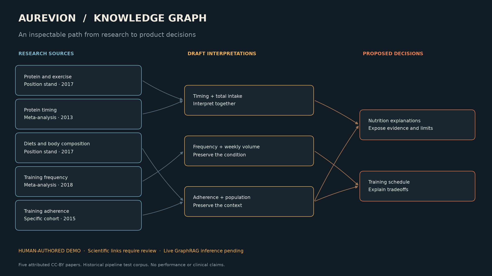

# Aurevion Knowledge Graph

[](https://colab.research.google.com/github/Demetri65/aurevion-knowledge-graph/blob/main/notebooks/01_graphrag_colab.ipynb)
[](https://github.com/Demetri65/aurevion-knowledge-graph/actions/workflows/verify.yml)

**Research passages → evidence context → reviewable product decisions.**

A Colab-first experiment using Microsoft GraphRAG and Gemini to investigate whether graph-assisted retrieval improves how we inspect fitness and nutrition evidence. The project connects an attributed research corpus, inspectable retrieval context, and explicit draft decision links.



The preview is a **human-authored demonstration**, not a model-generated GraphRAG result. Live model inference and retrieval performance have not yet been verified. The notebook keeps those states separate.

## Start in Colab

1. Click **Open in Colab** above. The notebook's first cell loads this public repository.
2. Alternatively, upload [`notebooks/01_graphrag_colab.ipynb`](notebooks/01_graphrag_colab.ipynb) to [Colab](https://colab.research.google.com/), clear `REPOSITORY_URL`, and upload `aurevion-knowledge-lab-colab.zip` when prompted. Build this bundle with `python scripts/package_colab.py`, or use the supplied local `dist/` bundle.
3. Run all cells with the default `RUN_LIVE = False`. Inspect the papers, interactive example graph, draft decision dependencies, coverage checks and portable exports.
4. For actual Gemini inference, add `GEMINI_API_KEY` to Colab Secrets and grant the notebook access. Check your API project's quota and billing, set `RUN_LIVE = True`, and start with the default **two abstracts**.
5. Enable `PERSIST_TO_DRIVE` before a live run to keep the response cache and completed index across sessions. The notebook stops if its structured-extraction or embedding smoke test fails.

The notebook loads the repository into its own runtime directory. For a reproducible published run, record the Git commit as well as the corpus and model fingerprint.

## What is here

| Component | Purpose |
|---|---|
| Five CC-BY article snapshots | Small historical pipeline corpus with authors, source IDs, licenses and SHA-256 hashes |
| Source-to-decision walkthrough | Human-authored draft claims, population context and proposed decision links |
| Pinned GraphRAG adapter | Standard indexing, local graph search and basic passage/vector search |
| Gemini smoke test | Structured source-quote extraction and finite 3,072-dimensional embedding check |
| Interactive graph | Inspect example links or actual extracted relationships in the notebook |
| Ten evaluation questions | Source coverage, applicability, disagreement, missing evidence and traceability |
| Portable artifacts | JSON, Parquet, HTML graph and a ZIP excluding credentials and raw model caches |
| Offline verification | Source integrity tests, adapter tests, notebook execution and CI |

## The experiment

The initial live run uses `gemini-3.1-flash-lite` and `gemini-embedding-001` with GraphRAG **3.3.0**. One concurrent request, two abstracts, a response cache and no extraction gleanings keep the first run bounded. Provider compatibility still requires the live smoke test.

The notebook compares **basic search** (passage/vector retrieval) with **local search** (graph-assisted context) on identical prepared documents. It presents generated citation markers separately from retrieved source context; each resolved passage links through its text-unit ID to its original document metadata. Retrieved context alone does not prove that an answer's claims are supported.

Standard GraphRAG proposes semantic entity relationships. FastGraphRAG's co-occurrence graph is a different indexing method. Neither establishes scientific certainty or approves a product decision automatically. [Microsoft's indexing methods](https://microsoft.github.io/graphrag/index/methods/)

Evaluate the actual answers before expanding the corpus. Scores begin empty; no quality advantage, cost saving or clinical benefit is claimed. See [the evaluation guide](docs/evaluation-guide.md).

## Google AI Pro and API access

Google's current plan documentation provides higher AI Studio UI access and describes eligible monthly Cloud credits for API usage. The direct API still uses a separately managed project and key. Colab benefits depend on membership eligibility. Check your own benefits rather than assuming subscription UI quota transfers to notebook calls. [Setup guide](docs/google-setup.md) · [Google AI plans](https://ai.google.dev/gemini-api/docs/google-ai-plans)

The key-free walkthrough requires no API credit or GPU. Live usage depends on your project quotas and billing. The usage ledger records observed LiteLLM token counts and available cost estimates; it is not a hard spend limit or a billing statement. Free-tier model input can be used to improve Google's products, so this experiment uses public licensed research rather than private user data.

## Run locally

Use Python **3.11–3.13**. Python 3.14 is outside the pinned GraphRAG release's supported range.

```bash
python3.11 -m venv .venv
source .venv/bin/activate
python -m pip install -e .
python -m unittest discover -s tests -v
python scripts/validate_notebook.py
python scripts/run_offline_notebook.py
python scripts/package_colab.py
```

For an interactive local session, install JupyterLab in this environment and open the source notebook:

```bash
python -m pip install jupyterlab
python -m jupyterlab notebooks/01_graphrag_colab.ipynb
```

`scripts/build_notebook.py` regenerates the committed, output-free source notebook. The execution script uses the active Python interpreter and writes its executed copy under ignored `runs/`. `scripts/render_demo.py` renders the README preview from the actual draft annotation records.

`docs/local-environment.txt` records the successful macOS/Python 3.12 validation environment. It is a reference snapshot, not a platform-independent lock file.

## Architecture and Aurevion integration

```text
Licensed source snapshots + manifest
             ↓
Deterministic, bounded document preparation
             ↓
Standard GraphRAG → Parquet graph tables + LanceDB vectors
             ↓
Basic/local retrieval → answer + inspectable context
             ↓
Human evaluation and explicitly reviewed decision links
```

Original corpus snapshots remain attributable and reproducible. Draft decisions live in `decisions/examples.json`; they are separate from model-extracted graph edges. A pure graph traversal can identify draft decisions affected by a source ID, while upstream correction detection remains future work.

When a source refresh changes XML, the prior XML and manifest are retained under ignored, hash-addressed `runs/source-history/` snapshots. This preserves prior input evidence; it does not automatically revise scientific interpretations or product rules.

This project is independent of Aurevion's application dependencies. The verified future boundary on `codex/tokens-grid` is `apps/api/app/features/evidence_knowledge`. Integration should be a separate pass that consumes reviewed portable records and measured retrieval behavior.

## Verification status

- **Verified locally:** 46 tests covering source identity/license/hash checks, deterministic preparation, actual GraphRAG 3.3.0 configuration, adapter behavior and recovery; the entire key-free notebook also executes successfully.
- **Pending:** a credentialed Gemini smoke test, live indexing, answers and scored retrieval comparisons; execution on a fresh hosted Colab runtime.
- **Remote verification:** GitHub Actions runs offline tests and notebook execution; its current result is shown in the badge above.

Microsoft currently describes GraphRAG as a research project in maintenance mode. The pinned adapter and portable outputs keep the experiment's findings independent of future framework choices. [Upstream project](https://github.com/microsoft/graphrag)

## Corpus and license

The five papers were published between 2013 and 2018 and are a **historical test corpus**, not a current comprehensive review. Position stands, meta-analyses and an observational cohort have different evidentiary roles. Population limits and truncation flags remain visible. [Corpus details and attribution](corpus/README.md)

Original project code is MIT licensed. Article XML retains its individual CC-BY license; the MIT license does not relicense those papers. Preserve source attribution, license links and transformation notices when sharing derived material.
